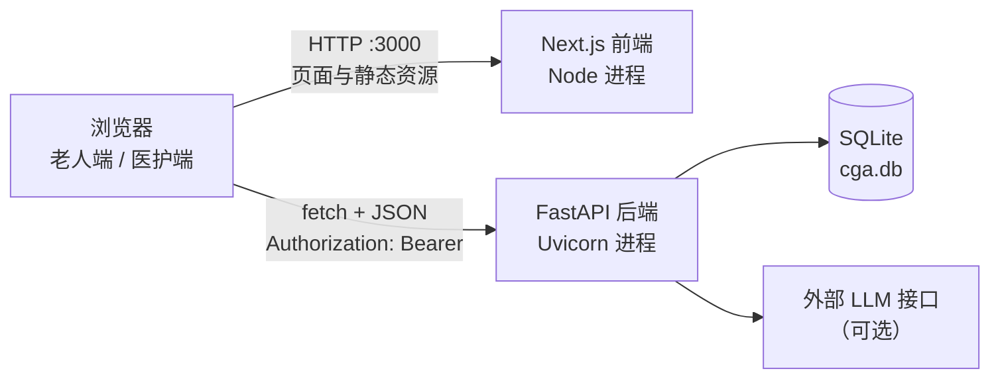
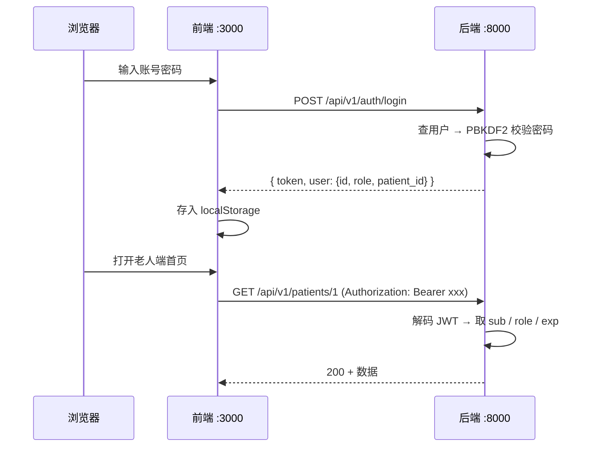
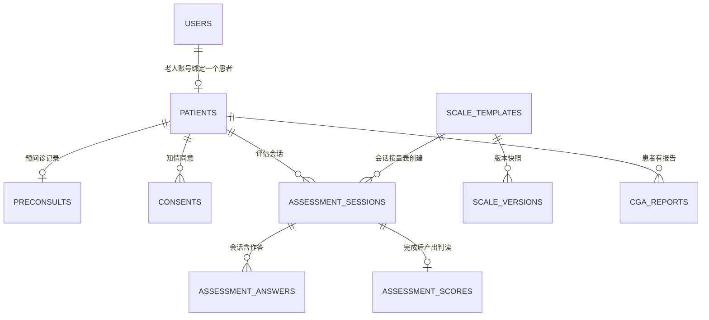
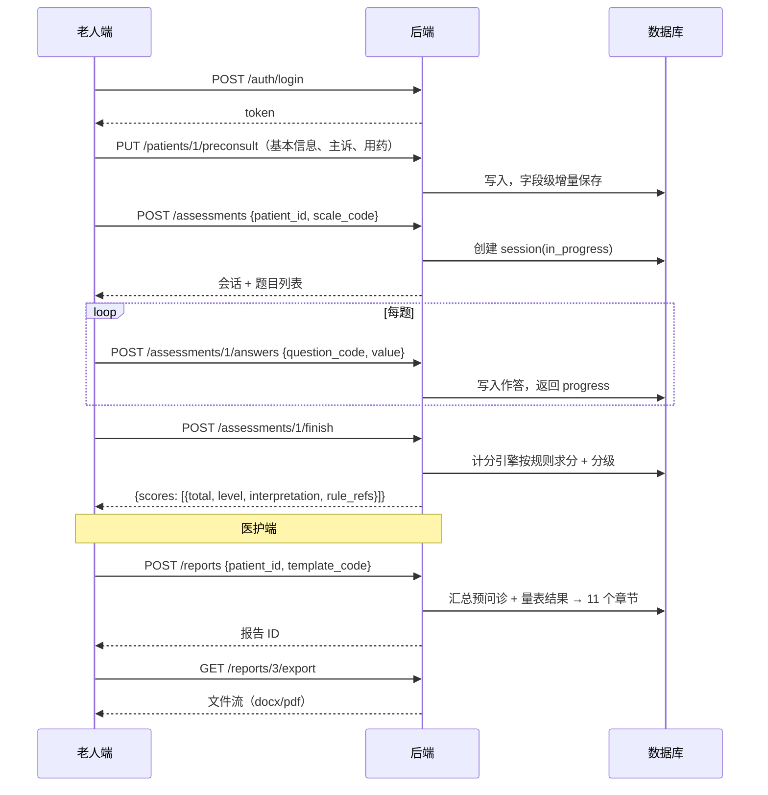

# 技术设计说明

> 课程：网络编程 · 期末作业
> 系统：老年人就医前预问诊与老年综合评估系统
> 仓库：`cga-preconsult`（前后端分离）
> 本机实测环境：Windows 11 + Python 3.13 + Node.js 22 + SQLite

---

## 1. 系统概述

### 1.1 选题背景

老年人就医时普遍存在三个问题：说不清病史、记不住用药、一次门诊时间不足以完成全面的功能评估。本系统把「就医前」这段时间利用起来，让老人在家或候诊时完成**预问诊信息采集**和**老年综合评估量表作答**，医生在接诊前就能拿到一份结构化报告。

### 1.2 系统做了什么

提供两个使用端：

| 端 | 使用者 | 核心操作 |
| --- | --- | --- |
| 老人端 | 老年人本人 / 家属代答 | 填基本信息与病史、作答量表、查看报告、呼叫工作人员、**扫码转到手机继续** |
| 医护端 | 护士 / 医生 / 管理员 | 建评估任务、查看作答进度、复核异常、生成与导出报告、**实时接收新评估与呼叫提示** |

核心业务链路只有一条，也是本次作业保证可用的主线：

```
老人登录 → 填写预问诊信息 → 选择量表作答 → 系统自动计分判读 → 生成综合评估报告 → 医生查看 / 导出
```

其余模块（AI 对话补充、疾病匹配、随访计划、质控看板）属于扩展功能，见第 9 节「范围说明」。

### 1.3 技术选型

| 层次 | 选型 | 理由 |
| --- | --- | --- |
| 前端 | Next.js 15（App Router）+ React 19 + TypeScript | 文件路由约定清晰；构建产物可直接静态化部署；类型系统能兜住接口字段改名 |
| UI | Tailwind CSS + Radix UI | 可做高对比、大字号的无障碍界面 |
| 后端 | FastAPI + Pydantic | 自带 OpenAPI 文档，接口即文档，便于前后端并行开发 |
| ORM | SQLAlchemy 2.0 | 模型即表结构定义，配合 Alembic 做版本化迁移 |
| 数据库 | SQLite（默认）/ PostgreSQL（可选） | 课程作业零外部依赖；同一套模型可切换生产库 |
| 鉴权 | JWT（HS256）+ PBKDF2 密码哈希 | 无状态，前后端分离部署简单 |
| 测试 | pytest + Vitest | 后端 337 条、前端 121 条 |

> 说明：本项目 15 个页面全部是客户端组件（`"use client"`），登录态存在 `localStorage`，所有数据请求都由浏览器直接发往后端。也就是说实际形态是「Next.js 承载的 SPA + 独立 API 服务」，**没有使用 SSR 数据获取**。选 Next.js 主要取其路由约定与构建能力，这一点在第 9 节也如实列出。

---

## 2. 网络架构

### 2.1 总体拓扑

系统采用 **B/S 架构 + 前后端完全分离**，两个独立进程通过 HTTP 通信：



要点：

- **两个端口，两种角色**。3000 只负责页面与静态资源，8000 只负责数据，互不代理。浏览器直接跨域请求 8000，因此后端必须开放 CORS。
- **所有数据请求都由浏览器发起**。页面是客户端组件，Next.js 不参与数据获取，只提供路由与打包。这条链路决定了三件事：token 必须存在浏览器（`localStorage`）、CORS 必须配置、401 需要前端统一拦截跳登录。
- **前后端唯一的耦合点是 HTTP 契约**（`docs/api-contract.md`），不共享代码、不共享类型文件。前端靠 TypeScript 手写类型，后端靠 Pydantic 校验入参。
- **数据库只被后端访问**，前端拿不到任何连接串，这也是分离架构的安全边界。

### 2.2 端口与地址约定

| 服务 | 监听地址 | 用途 |
| --- | --- | --- |
| 前端 | `127.0.0.1:3000` | 页面入口 |
| 后端 | `127.0.0.1:8000` | REST API |
| 后端 | `127.0.0.1:8000/docs` | 自动生成的 Swagger UI |
| 后端 | `127.0.0.1:8000/health` | 健康检查（供启动脚本与容器探针使用） |

### 2.3 统一响应信封

所有 `/api/v1/*` 接口返回同一层外壳，避免前端为每个接口写不同的解析逻辑：

```json
{ "code": 0, "message": "ok", "data": { ... } }
```

- `code = 0` 表示业务成功；非 0 表示业务失败（HTTP 状态码同步为 4xx/5xx）。
- 出错时 `data` 为 `null`，`message` 是可直接展示给用户的中文原因。

实现上有两道保障：路由层用自定义 `EnvelopeRoute` 包装返回值，中间件层再做一次兜底（仅针对 `application/json` 且状态码 200 的响应），避免框架版本差异导致某个路由漏包。`/health` 和根路径不做包装，便于容器和监控直接读取。

### 2.4 跨域（CORS）

开发期前端 `3000` 与后端 `8000` 不同源，浏览器会先发 `OPTIONS` 预检。后端配置：

```python
allow_origins=cors_origins.split(",")   # 默认 http://127.0.0.1:3000,http://localhost:3000
allow_origin_regex=cors_origin_regex    # 放行 RFC1918 私有网段
allow_credentials=True
allow_methods=["*"]
allow_headers=["*"]
```

固定白名单由 `CGA_CORS_ORIGINS` 控制。另外单独配了一条正则，放行 `10.x` / `172.16-31.x` / `192.168.x` 网段来源——手机扫码访问时页面来自 `http://192.168.x.x:3000`，不在固定白名单里，不放行会被浏览器拦掉所有请求（表现为页面打开一片空白、控制台报 CORS）。放行范围限于私有网段，公网来源仍被拒。

### 2.5 流式传输（SSE）

AI 对话补充模块需要「边生成边显示」，用的是 **SSE（Server-Sent Events）**：

- 接口：`POST /api/v1/dialogue/sessions/{session_id}/messages/stream`
- 响应头：`Content-Type: text/event-stream`
- 后端用 `StreamingResponse` 逐条 `yield` 已格式化的 `data:` 帧

选 SSE 而不是 WebSocket，原因是这个场景只有服务端单向推送，不需要双向通道；SSE 走普通 HTTP，天然复用现有鉴权头和 CORS 配置，实现成本低得多。

### 2.6 实时通知（WebSocket）

医护端需要「有人完成评估 / 有人按呼叫」时立刻知道，而不是等手动刷新。轮询能做到但延迟高、空请求多，这里用一条 WebSocket 长连接：

- 地址：`ws://<host>:8000/api/v1/ws/notifications`
- 事件：`{"type": "assessment.submitted" | "assistance.requested", "at": "...", "data": {...}}`
- 心跳：客户端每 25 秒发 `{"type":"ping"}`，服务端回 `pong`
- 重连：指数退避 1s → 2s → 4s …，上限 30s

**鉴权为什么不用 `Authorization` 头**

浏览器的 `WebSocket` 构造函数不支持自定义请求头，只能带 URL 与子协议。把 token 拼进 query 会被 Nginx / 网关的访问日志完整记录下来，是常见的凭证泄露来源。因此这里采用**握手后首帧鉴权**：

```text
客户端 connect
服务端 accept()
客户端 → {"token": "<JWT>"}        （5 秒内必须发）
服务端 → {"type":"ready", ...}     （通过）
服务端 → close(4401)               （超时或无效）
```

**广播的实现约束**

业务路由大多是同步函数，被 FastAPI 放进线程池执行，不能直接 `await`。做法是在应用启动时记下主事件循环，业务线程用 `asyncio.run_coroutine_threadsafe` 把广播任务投递回去，不阻塞当前请求。投递失败只记日志——实时通知属于增强能力，**绝不能因为它让「提交评估」这类主流程报错**。

广播按角色过滤：只推给 `doctor` / `staff` / `admin`，老人端连接收不到临床事件。单条连接发送失败会被自动移除，不影响其他连接。

### 2.7 手机扫码接入（局域网）

老人端做了移动端适老化，但老人得先知道网址才能在手机上打开。系统提供扫码入口，涉及三个环节：

| 环节 | 做法 | 原因 |
| --- | --- | --- |
| 取局域网地址 | 后端 `GET /system/lan-addresses` | 浏览器拿不到可靠的网卡地址 |
| 拼页面 URL | 前端用当前页面的协议/端口 + 后端返回的 IP | 端口只有前端自己知道 |
| 生成二维码 | 浏览器端用 canvas 生成，不调外网服务 | 断网环境也能用 |

**主地址怎么选**（这里有坑）：不能简单按网段排序。Windows 装了 VMware / VirtualBox / WSL 后，网卡列表里会多出若干 `192.168.x.1` 这类宿主机虚拟地址，它们看着像家用路由器网段，手机根本连不上。正确做法是以**默认路由出口地址**为准——用 `socket` 对 `8.8.8.8` 做一次 UDP `connect`，UDP 无连接，这一步只让内核选网卡并记下对端，**不会真的发包**，因此不要求外网连通。拿到的地址对应的网卡一定能出网，把它置顶，其余按网段作备选，UI 上允许用户手动切换。

**API 地址必须跟随访问来源**：手机打开的是 `http://10.x.x.x:3000`，如果前端仍去请求 `http://127.0.0.1:8000`，请求的是手机自己的回环地址，必然失败。所以前端推导 API 基址时，若配置里是回环地址而页面来自局域网 IP，就把 host 换成当前访问的 host（端口与路径不变）；配置成真实域名时不做改写，避免破坏生产部署。

---

## 3. HTTP API 设计

### 3.1 设计原则

1. **资源化路径**：路径是名词（`/patients`、`/assessments`），动作交给 HTTP 方法。
2. **两级资源嵌套表达从属关系**：`/patients/{patient_id}/assessments` 表示该患者的评估列表；独立的 `/assessments/{session_id}` 表示按会话 ID 直接操作。
3. **所有列表接口都支持分页**，统一用 `page` / `page_size`。
4. **业务状态用资源内的字段表达**，不设计 `/finish` 这类动词之外的隐式跳转——但保留少量必要动作端点（如 `/assessments/{id}/finish`），因为它们改变的是状态机而非资源本身。

### 3.2 接口规模

`/api/v1` 下共 **74 个业务端点**，按模块拆在 14 个路由文件里（另有 1 个 WebSocket 端点见 2.6）：

| 模块 | 文件 | 端点数 | 说明 |
| --- | --- | --- | --- |
| 量表 | `scales.py` | 10 | 量表树、版本、评审结论、白话文改写 |
| 患者 | `patients.py` | 9 | 建档、预问诊信息、知情同意、时间线 |
| 评估 | `assessments.py` | 9 | 建会话、逐题作答、跳过、完成、复核、批量派发 |
| 疾病匹配 | `matching.py` | 9 | 匹配运行、结果查询、定期评估触发 |
| 管理 | `admin.py` | 7 | 用户、提示词模板、阈值配置 |
| 报告 | `reports.py` | 6 | 生成、详情、锁定版本、导出 |
| 对话 | `dialogue.py` | 5 | 会话、消息、流式消息、健康画像 |
| 随访 | `followups.py` | 5 | 随访计划、完成随访 |
| 老人协助 | `elder.py` | 5 | 字号偏好、一键呼叫工作人员 |
| 疾病库 | `knowledge.py` | 3 | 疾病条目查询 |
| 鉴权 | `auth.py` | 2 | 登录、取当前用户 |
| 提醒 | `alerts.py` | 2 | 就医提醒列表与处置 |
| 系统信息 | `system_info.py` | 1 | 局域网地址探测（扫码用） |
| 复核 | `reviews.py` | 1 | 人工复核队列 |
| **合计** | | **74** | 另有 `/` 与 `/health` 两个运维端点不在此列 |

### 3.3 鉴权流程



- **密码存储**：不存明文，存 `pbkdf2_sha256$迭代次数$盐$摘要`，校验时用同盐重算比对。
- **Token 载荷**：`sub`（用户 ID）、`role`、`username`、`iat`、`exp`，默认有效期 **720 分钟**。
- **越权防护**：拿到 token 只代表「登录了」，不代表「能看任何数据」。每次访问患者数据都会执行 `ensure_patient_access(user, patient_id)`——老人角色只能访问自己绑定的 `patient_id`，越界直接 403。

这一点是分离架构下最容易出事的地方：JWT 是无状态的，**授权判断必须在每个涉及患者数据的接口里重做一遍**，不能只靠前端隐藏菜单。

### 3.4 状态码约定

| 状态码 | 含义 | 典型场景 |
| --- | --- | --- |
| 200 | 成功 | 所有正常响应（业务成功时 `code=0`） |
| 400 | 参数错误 | 缺 `question_code`、会话已结束仍提交答案 |
| 401 | 未认证 | 未带 token、token 过期 |
| 403 | 无权限 | 老人访问他人数据、非医护人员调用医护接口 |
| 404 | 资源不存在 | 会话 / 报告 ID 不存在 |
| 422 | 校验失败 | Pydantic 模型字段类型不符 |

---

## 4. 数据库设计

### 4.1 规模与分层

共 **30 张表**，按职责分组如下（表名即实际建表名）：

| 分组 | 表 | 说明 |
| --- | --- | --- |
| 账号与审计 | `users`、`audit_logs` | 四类角色（admin / doctor / staff / elder）、操作留痕 |
| 患者与病史 | `patients`、`preconsults`、`consents`、`patient_medical_profiles` | 基本信息、预问诊 JSON 记录、知情同意、健康画像 |
| 量表与版本 | `scale_templates`、`scale_versions`、`template_approvals` | 量表定义、历史版本快照、评审结论 |
| 评估作答 | `assessment_sessions`、`assessment_answers`、`assessment_scores` | 会话状态机、逐题作答、判读结果 |
| AI 对话 | `ai_dialogue_sessions`、`ai_dialogue_turns`、`model_runs` | 对话记录、模型调用留痕 |
| 疾病库与匹配 | `disease_profiles`、`disease_symptoms`、`disease_differentials`、`matching_rules`、`match_runs`、`match_candidates`、`match_ai_reviews` | 疾病档案、症状权重、鉴别要点、匹配运行与候选 |
| 报告 | `cga_reports`、`report_templates` | 报告正文（JSON 章节）、报告模板 |
| 提醒与随访 | `alerts`、`alert_thresholds`、`followups`、`periodic_assessments` | 就医提醒、阈值配置、随访计划、定期评估 |
| 协助与配置 | `assistance_requests`、`prompt_templates` | 一键呼叫工作人员、提示词模板 |

### 4.2 核心表关系



### 4.3 关键设计决策

**（1）题库用 JSON payload + 版本快照，而不是拆成多张表**

一开始考虑过把题库拆成「量表 → 分组 → 题目 → 选项」四张表，最后选择把整份量表定义序列化成 JSON 存进 `scale_templates.payload`。理由是：

- 量表定义不是扁平数据，题目里还嵌着选项、赋分值、输入类型、必答标记，外层还有分组、分支跳转（`branches`）、计分规则（`scoring`）。拆表后读一次量表要 join 四五层再在内存里重建树，代码比直接读 JSON 复杂得多。
- 作答和计分只关心「这张量表当前版本长什么样」，一次 `SELECT payload` 就能把完整定义交给计分引擎。
- 版本化更自然：`scale_versions` 存每次改动的完整快照（`scale_code` + `version` + `payload`），回滚时取旧版本即可，不会出现「题目表被改了，历史作答对不上」的问题。
- 代价是不能用 SQL 直接查「所有量表中含某道题的记录」。但实际没有这种需求，21 张量表的定义在启动时就能全量加载进内存。

**（2）作答按「一题一行」存**

`assessment_answers` 每行是（会话 ID、`question_code`、`value`、`score`、`measured`、`skipped`、`skip_reason`、`proxy_flag`、`answered_by`、`answer_source`）。

好处是断点续填、单题修改、代答留痕、跳过原因都能精确到题；代价是查询整份作答要聚合，但单份量表作答在十到几十行量级，聚合成本可忽略。

**（3）判读结果独立成表，且保留复核前后两份**

`assessment_scores` 不只存最终分，还存了 `rule_version`（用了哪版规则）、`rule_refs`（逐项得分明细）、`missing_items`（缺项）、`needs_manual_review`（是否待人工确认），以及 `pre_review_total` / `pre_review_level`（复核前的原始结论）。

这样人工复核改了结论之后，原始自动判读不会消失，能回答「系统当时是怎么判的、谁改的、改成什么」。

**（4）迁移即真相**

表结构以 SQLAlchemy 模型 + Alembic 迁移为唯一来源，不维护手写 DDL。容器启动时先 `alembic upgrade head` 再起服务，避免「模型改了但库没改」的经典事故。

**（5）SQLite 与 PostgreSQL 双支持**

```python
database_url: str = ""   # 为空时回落 SQLite backend/data/cga.db
```

课程演示用 SQLite（零安装、单文件可拷贝），生产切 `CGA_DATABASE_URL=postgresql+psycopg://...` 即可，模型层不用改。SQLite 不支持 `ALTER COLUMN`，因此 Alembic 开了 `render_as_batch=True`，把改列操作降级为「建新表 → 拷数据 → 换名」。

---

## 5. 关键业务流程

### 5.1 主链路时序



### 5.2 计分引擎

`finish` 接口不只是一个状态翻转，它触发判读。整个判读规则就写在量表 JSON 的 `scoring` 字段里，分三块：

| 字段 | 用途 | 示例 |
| --- | --- | --- |
| `score` | 求原始分 | `{"rule_type": "sum", "config": {"items": [...]}}` |
| `levels` | 原始分到分级区间的映射 | `{"rule_type": "level_map", "config": {"levels": [{"min": 0, "max": 40, "level": "重度依赖", ...}]}}` |
| `flags` | 条件触发的问题标记 | `B1-09 < 15` → 标记「行走能力受限」，并关联症状编码 `difficulty_walking` |

执行顺序：

1. 按 `score` 求原始分（求和 / 计数 / 取最值）。
2. 拿原始分到 `levels` 里匹配区间，得到 `level`（如「无依赖」）和 `interpretation`（如「基本日常生活活动完全自理」），同时带出 `abnormal` 与 `severity`。
3. 逐条跑 `flags` 条件规则，命中就把问题标记和对应症状编码写进 `flags` 字段，供后续疾病匹配使用。
4. 缺项和超范围值不做猜测，标记 `needs_manual_review`，交人工复核。
5. 返回体里带 `rule_refs`——把用了哪些题、各自满分多少、实际得分多少全部列出，保证结论可追溯。

实测样例（B.1 基本日常生活活动能力量表，10 题全选最高档）：

```json
{
  "scale_code": "B.1",
  "total": 100.0,
  "level": "无依赖",
  "interpretation": "基本日常生活活动完全自理。",
  "abnormal": false,
  "rule_refs": [{ "rule": "score:sum", "answered_count": 10, "total_count": 10 }]
}
```

### 5.3 报告生成

报告固定 11 个章节，按数据可用性逐章填充，缺数据的章节留空而不是编造：

`basic`（基本信息）、`history`（病史）、`scale_results`（量表结果）、`dimension_summary`（四维小结）、`positive_list`（阳性清单）、`ai_supplement`（AI 补充）、`disease_match`（疾病匹配）、`interventions`（干预建议）、`mdt_opinions`（多学科意见）、`followup_plan`（随访计划）、`archive`（归档信息）。

报告生成后可 `POST /reports/{id}/lock` 锁定版本，锁定后内容不可改，保证医疗文书的可审计性。

---

## 6. 安全设计

| 风险 | 措施 |
| --- | --- |
| 密码泄露 | PBKDF2-SHA256 加盐哈希，库中无明文 |
| Token 伪造 | HS256 签名，密钥由 `CGA_JWT_SECRET` 注入，不进代码仓库 |
| 越权访问他人数据 | 每个涉及患者数据的接口单独调 `ensure_patient_access` |
| 跨站请求 | CORS 白名单限定来源，不用 `*` |
| 操作不可追溯 | `audit_logs` 记录操作人、动作、资源、版本 |
| 老人端误操作 | 关键操作二次确认；一键呼叫工作人员独立于医疗提醒，不混入提醒统计 |

需要说明的是：本作业**没有做** HTTPS、刷新令牌、速率限制。这些在真实医疗系统里是必需的，课程环境下简化了，理由见第 9 节。

---

## 7. 部署与运行

### 7.1 本地一键启动

仓库根目录提供两个脚本，自动完成环境检查、依赖安装、服务拉起：

```powershell
.\start.ps1            # Windows：起后端 + 前端，各开一个窗口
.\start.ps1 -Check     # 只检查环境
```

```bash
./start.sh             # Linux / macOS
./start.sh check
```

脚本依次完成：检查 python/node/pnpm 是否可用 → 缺虚拟环境就建 → 缺依赖就装 → 检查 8000/3000 端口是否被占用 → 启动服务并轮询 `/health` 直到就绪。

### 7.2 手工启动

```powershell
# 终端 1：后端
cd backend
.\.venv\Scripts\python.exe -m uvicorn app.main:app --reload --port 8000

# 终端 2：前端
cd frontend
pnpm dev --port 3000
```

### 7.3 环境变量

统一前缀 `CGA_`，全部有默认值，不配置也能跑：

| 变量 | 默认 | 说明 |
| --- | --- | --- |
| `CGA_DATABASE_URL` | 空（用 SQLite） | 生产填 PostgreSQL 连接串 |
| `CGA_JWT_SECRET` | 开发默认值 | **上线必须替换** |
| `CGA_ACCESS_TOKEN_EXPIRE_MINUTES` | 720 | Token 有效期 |
| `CGA_CORS_ORIGINS` | `http://127.0.0.1:3000,...` | 允许的前端来源 |
| `CGA_AUTO_CREATE_TABLES` | `true` | 容器里置 `false`，只认迁移 |

### 7.4 演示账号

| 角色 | 账号 | 密码 |
| --- | --- | --- |
| 老人 | `elder` | `elder12345` |
| 医生 | `doctor` | `doctor12345` |
| 护士 | `nurse` | `nurse12345` |
| 管理员 | `admin` | `admin12345` |

首次启动会自动建表并写入演示数据（患者、21 张量表、疾病库、报告模板），整个过程幂等，重启不会重复插入。

### 7.5 Docker（可选）

提供 `docker-compose.yml`，用于一条命令起 PostgreSQL + 后端 + 前端。容器内后端启动命令是 `alembic upgrade head && uvicorn ...`，保证建表只发生在迁移阶段。

Docker 方案属于加分项，未在本机完整验证（本机 Docker 守护进程未启动），本地演示以 `start.ps1` 为准。

---

## 8. 测试与质量保障

| 项 | 数量 | 说明 |
| --- | --- | --- |
| 后端单元/接口测试 | **337 条** | pytest，覆盖鉴权、越权、计分、报告、迁移、实时通知 |
| 前端单元测试 | **121 条** | Vitest，覆盖字号偏好、格式化、地址推导、二维码往返 |
| 契约校验 | 74 个端点 | `tools/contract_diff.py` 对比文档声明与代码实现 |
| 前端调用覆盖 | **94 条调用 / 0 失配** | `tools/check_frontend_api.py` 对比前端调用与后端实际端点 |

**契约校验**：`docs/api-contract.md` 里的端点清单与代码实际注册的路由逐一比对，任何一侧多了或少了都会在 CI 里报红。比较时按**路径形状**而非参数名比对（`{id}` 与 `{session_id}` 视为同一形状），避免参数命名差异造成误报。

**前端调用覆盖**：前后端分离项目最常见的事故是「前端调了一个后端并没有的接口」——编译不报错、点下去才 404。这个脚本扫描 `frontend/src` 里所有 `api.get/post/put/patch/delete` 与 `request()` 调用，把路径里的 `` `${id}` `` 归一化成 `{}`，与 FastAPI 生成的 OpenAPI 路径逐一比对。

当前结果：

```text
后端 /api/v1 端点形状: 74
前端调用: 94  匹配: 94  未匹配: 0
```

脚本不启动服务（直接生成 OpenAPI schema），因此可以直接放进 CI。

**迁移防线**：后端测试里专门有一组针对迁移的用例——能升级、能降级、模型与迁移无差异、配置文件可被正确解析。这几条能挡住「改完模型忘了生成迁移」这个高频失误。

---

## 9. 范围说明与简化取舍

课程作业的投入是有限的，以下是本次**主动简化**的部分，以及理由：

| 模块 | 处理方式 | 理由 |
| --- | --- | --- |
| 预问诊采集 | **完整实现** | 作业核心，必须可用 |
| 21 张量表作答与计分 | **完整实现** | 作业核心，必须可用 |
| 综合评估报告 | **完整实现** | 作业核心，必须可用 |
| 手机扫码接入 | **完整实现**（本轮新增） | 老人端移动化改造的最后一公里，涉及局域网地址探测与 CORS |
| 实时通知 | **完整实现**（本轮新增） | WebSocket 长连接、首帧鉴权、按角色广播、断线重连 |
| AI 对话补充 | 已实现，作为扩展保留 | 依赖外部模型服务，未配置密钥时不可用，不列入主链路 |
| 疾病匹配 Top-3 | 已实现，作为扩展保留 | 需要标注集评估准确率，超出课程工作量，不做指标论证 |
| 随访计划 / 定时评估 | 已实现，作为扩展保留 | 需要 Celery + Redis，仅代码保留，不保证运行环境 |
| 质控看板 | 已实现，作为扩展保留 | 统计口径需要临床确认，暂不出结论 |
| 前端 SSR / 服务端渲染 | **未使用** | 15 个页面均为客户端组件，数据由浏览器直连 API。本作业考察的是前后端分离与 HTTP 交互，SSR 不在范围内 |
| HTTPS / 刷新令牌 / 限流 | **未做** | 课程环境为本地回环，属于部署层能力而非编程能力 |
| 模型评测（标注集 200 条） | **未做** | 属于科研评估工作，与网络编程课程目标无关 |

**结论**：主链路（登录 → 预问诊 → 量表 → 计分 → 报告 → 导出）已端到端实测通过，可独立演示；扩展模块保持代码完整但不投入额外精力。

---

## 10. 后续可改进方向

1. **接口版本化**：目前只有 `v1`，未来破坏性变更时应并行提供 `v2`，而不是原地改。
2. **Token 无感刷新**：改为 access + refresh 双令牌，避免 12 小时后突然掉线。
3. **前端类型由 OpenAPI 生成**：现在手写 TypeScript 类型，字段改名容易漏改，可从 `/openapi.json` 自动生成。
4. **作答接口批量化**：现在逐题提交，网络往返多；可提供批量提交接口并以单题接口做增量保存。
5. **导出改为异步任务**：报告导出目前同步生成，数据量大时会超时，可改为任务队列 + 轮询。
