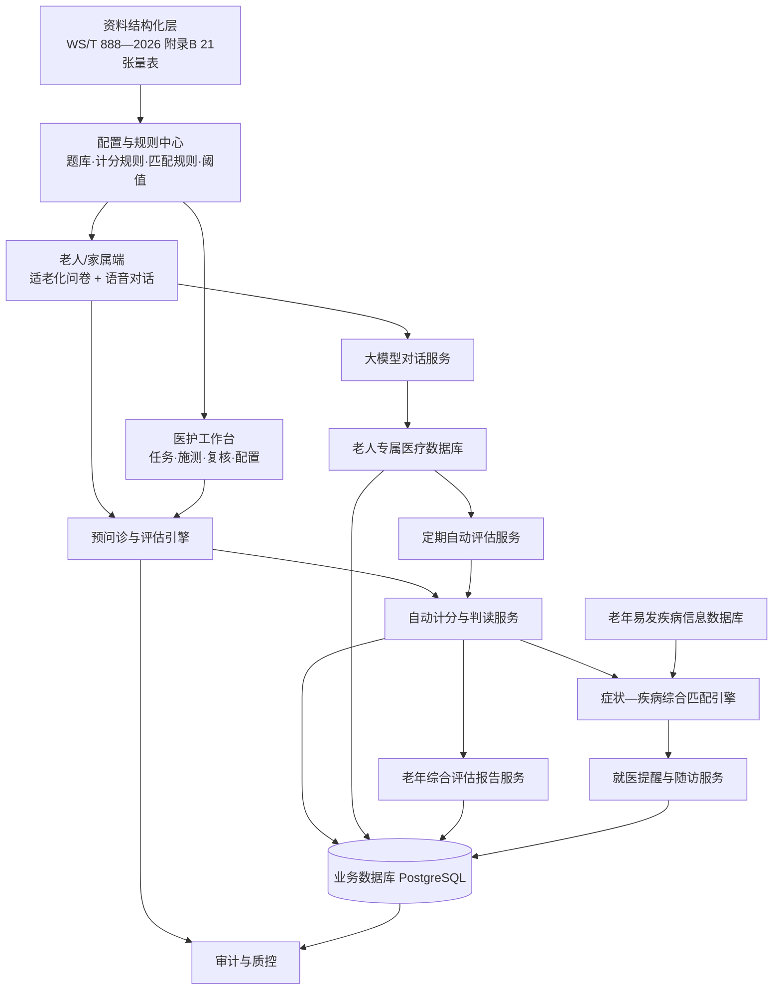
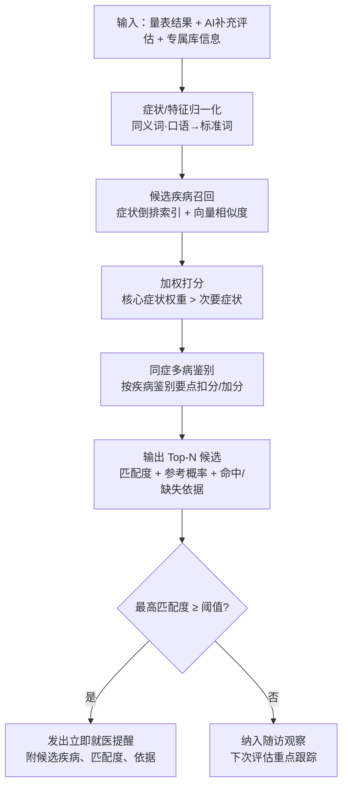
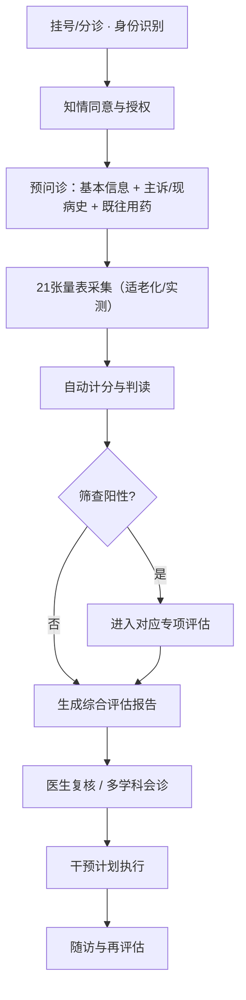
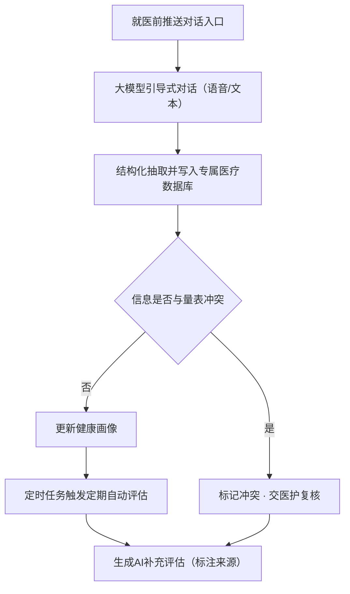
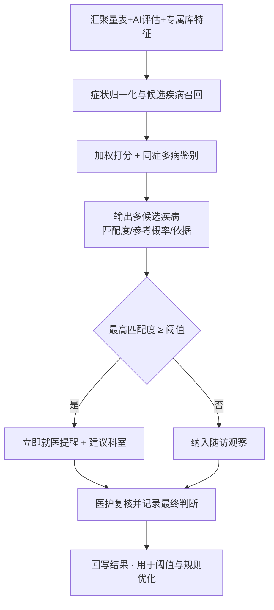

# 老年人就医预问诊与老年综合评估系统 · 项目构想总需求

## 1. 项目定位

本项目面向**老年人就医前预问诊**场景，建设一套“**21 张量表规范采集 + 大模型对话补充 + 老年综合评估报告生成 + 易发疾病匹配提醒**”的适老化智能平台。

系统解决的核心问题：

- 老年人不会用智能设备、看不清、听不清、只讲方言，预问诊“第一步”就走不通；
- 21 张量表题量大、术语晦涩、筛查—评估分支复杂，人工施测耗时长、易漏项、难质控；
- 量表结果分散、医生需手工汇总，综合评估报告生成慢、格式不统一；
- 纸质/单次评估无法形成动态健康画像，评估—干预—随访闭环断裂。

系统分两端使用：

- **老人／家属端**：适老化问卷填写、语音对话、查看报告与就医提醒；
- **医护端**：评估任务管理、施测与复核、报告审核、疾病库与阈值配置、统计质控。

### 1.1 建设依据

| 类别 | 依据 | 在本项目中的用途 |
| --- | --- | --- |
| 行业标准 | **WS/T 888—2026《医疗机构老年综合评估技术操作标准》** | 评估原则、对象、内容方法、**附录 B 的 21 张量表**、流程与质控 |
| 行业标准 | GB/T 42195—2022《老年人能力评估规范》 | 吞咽障碍筛查等引用量表 |
| 行业标准 | WS/T 802—2022《中国健康老年人标准》 | 抑郁、焦虑、社会支持等配套量表 |
| 行业标准 | WS/T 484《老年人健康管理技术规范》 | 认知功能评估（附录 C 表 C.1） |
| 行业规范 | MZ/T 185《养老机构预防老年人跌倒基本规范》 | 跌倒风险评估（表 A.1） |
| 法规 | 《个人信息保护法》《医疗机构病历管理规定》《电子病历应用管理规范（试行）》 | 知情同意、最小必要采集、加密与审计 |

> **标准符合性是本项目的硬约束**：21 张量表的题目、选项、分值、判读阈值一律以标准原文为准，不得由大模型自由生成或隐式修改。

### 1.2 项目边界

| 范围内 | 范围外 |
| --- | --- |
| 预问诊信息与病史采集 | 检查检验（LIS/PACS）系统建设 |
| 21 张量表采集、自动计分与判读 | 替代医生做出诊断 |
| 老年综合评估报告生成与导出 | 医保结算、处方流转 |
| 大模型对话、定期评估、专属医疗数据库 | 大模型自训练／微调（使用成熟 API） |
| 易发疾病知识库、症状—疾病匹配、就医提醒 | 急诊分诊与急救调度 |
| 随访提醒与再评估 | 全院级数据中台建设 |

## 2. 资料与数据范围

| 资料类别 | 当前来源 | 系统用途 |
| --- | --- | --- |
| 21 张量表原文 | `量表评估国家标准.pdf`（WS/T 888—2026 附录 B） | 题库配置、计分规则、判读阈值 |
| 结构化量表清单 | `docs/structured/assessment-scales/`（待建设） | 数据库导入源、版本管理基线 |
| 老年易发疾病知识 | 诊疗指南、权威医学科普资料（待整理并标注来源） | 疾病特征库、症状匹配、鉴别要点 |
| 适老化交互文案 | 医护与老年用户共创（待评审） | 题目口语化、语音话术、提醒文案 |
| 报告模板 | 依据标准第 9 章报告要求编制 | 综合评估报告导出 |

## 3. 用户角色

| 角色 | 主要能力 |
| --- | --- |
| 老年人 | 完成预问诊与 21 张量表作答／受测；与大模型语音对话；查看报告与就医提醒 |
| 家属／照护者 | 协助操作、代答、补充病史；接收提醒与随访通知 |
| 评估人员（护士／技师） | 创建评估任务、现场施测（视力/听力/体能/吞咽）、录入与复核 |
| 医生（老年医学科／全科） | 复核综合评估报告、确认阳性问题、制定干预计划 |
| 多学科团队 | 营养、康复、心理、药学、社工基于报告给出协同意见 |
| 知识库管理员 | 维护易发疾病库、匹配规则、阈值与提醒文案（需审批） |
| 系统管理员 | 账号、角色、权限、量表版本、审计与统计 |

## 4. 总体系统架构

## 5. 核心模块设计

### 5.1 预问诊与病史采集模块

在正式就诊前完成身份识别、知情同意、基本信息与病史采集，为量表评估和 AI 对话提供上下文。

| 能力 | 说明 |
| --- | --- |
| 身份识别 | 身份证／社保卡／就诊卡／人脸；与院内 HIS 患者主索引对齐 |
| 知情同意 | 评估目的、数据用途、AI 参与范围、可随时退出；留痕可追溯 |
| 基本信息 | 性别、年龄、婚姻、教育程度、居住状况、医疗费别、联系人 |
| 主诉与现病史 | 结构化录入 + 语音录入；起病时间、部位、性质、程度、演变、伴随症状 |
| 既往史／用药史／过敏史 | 慢病清单、长期用药、最近调整、过敏药物与反应 |
| 生活方式 | 吸烟、饮酒、饮食、活动、睡眠、跌倒史 |
| 智能追问 | 关键阳性回答触发细化追问（如跌倒史→时间/地点/诱因/损伤） |

### 5.2 21 张量表评估中心

依据 WS/T 888—2026 附录 B，按“一般情况—躯体功能—精神心理—社会与环境—老年综合征”组织。

| 编号 | 量表名称 | 维度 | 采集方式 | 判读要点（以标准原文为准） |
| --- | --- | --- | --- | --- |
| B.1 | 基本日常生活活动能力评估量表 | 躯体功能 | 询问／他评 | 10 项之和；≤40 重度、41~60 中度、61~99 轻度依赖，100 无依赖 |
| B.2 | 工具性日常生活活动能力量表 | 躯体功能 | 询问／他评 | 8 项之和；8 正常，6~7 轻度，3~5 中度，≤2 严重依赖 |
| B.3 | 简易体能状况量表（SPPB） | 躯体功能 | 实测 | 平衡+步速+5 次起坐；10~12 良好，7~9 中等，0~6 较差 |
| B.4 | 视力简易评估表 | 躯体功能 | 实测 | 4 正常，3 低视力，1~2 盲，0 完全失明（可佩戴眼镜） |
| B.5 | 视觉功能简易评估表 | 躯体功能 | 询问 | 3 良好，2 较差，≤1 差 |
| B.6 | 听力简易评估表 | 躯体功能 | 实测／询问 | 4 正常，3 下降，1~2 障碍，0 完全失聪（可佩戴助听器） |
| B.7 | 耳语试验 | 躯体功能 | 实测 | 任一侧无法正确重复 ≥3 个词语为阳性 |
| B.8 | 简易智力评估量表 | 精神心理 | 施测 | 名词回忆+画钟；0~2 筛查阳性，3~5 筛查阴性 |
| B.9 | 居家环境筛查表 | 社会与环境 | 询问／查看 | 14 项之和；得分越低风险越大 |
| B.10 | FRAIL 量表 | 老年综合征 | 询问 | ≥3 条衰弱，1~2 条衰弱前期，0 条无衰弱 |
| B.11 | 尿失禁问卷（ICIQ-SF） | 老年综合征 | 询问 | 第 1、2、3 项之和；分值越高症状越重 |
| B.12 | 便秘症状评估表 | 老年综合征 | 询问 | 按症状条目判断有无便秘及类型 |
| B.13 | 阿森斯失眠量表（AIS） | 老年综合征 | 自评 | 8 条目×0~3；0~3 无，4~6 可能，≥6 存在睡眠障碍 |
| B.14 | 慢性疼痛数字评分（NRS） | 老年综合征 | 自评 | 1~3 轻度，4~6 中度，7~10 重度 |
| B.15 | 慢性疼痛行为评估量表 | 老年综合征 | 他评 | 3~12 分，分值越高疼痛越重 |
| B.16 | 压力性损伤风险（Braden） | 老年综合征 | 他评 | 15~18 低度，13~14 中度，10~12 高度，≤9 极高度 |
| B.17 | 洼田饮水试验 | 老年综合征 | 实测 | Ⅰ~Ⅴ 级，级别越高吞咽障碍越重 |
| B.18 | 营养风险筛查（NRS2002） | 老年综合征 | 询问／测量 | 0~2 分每周复评，3~7 分存在营养风险 |
| B.19 | 微营养评定（MNA-SF） | 老年综合征 | 询问／测量 | 总分 ≤11 为营养不良风险 |
| B.20 | GLIM 营养不良诊断 | 老年综合征 | 评估 | 含诊断、肌肉减少、病因型指标、严重程度分级 4 项分标准 |
| B.21 | 谵妄（意识模糊）评估 | 老年综合征 | 评估 | 依据意识状态条目判断有无谵妄 |

量表中心需支持：

| 能力 | 说明 |
| --- | --- |
| 题库配置化 | 量表→分组→题目→选项→分值→判读规则全部入库，支持版本化 |
| 分支跳转 | 筛查阳性自动进入对应专项评估，阴性跳过，避免漏项与误跳 |
| 自动计分 | 支持求和、加权、取最值、分级映射、组合条件等规则类型 |
| 结果判读 | 输出分值、等级、阴阳性与标准依据条文号 |
| 断点续填 | 分次采集，按老人+量表恢复进度，适配老年人疲劳 |
| 实测项支持 | 步速计时、5 次起坐计时、握力、小腿围、耳语、饮水试验的录入与计时引导 |
| 版本留痕 | 每次评估记录所用题库与规则版本 |

### 5.3 自动计分与判读引擎

| 设计点 | 要求 |
| --- | --- |
| 规则可解释 | 每个结论可回溯到题目作答与规则条目 |
| 与标准一致 | 阈值、分级与 WS/T 888—2026 附录 B 一致，变更需审批 |
| 异常兜底 | 缺项、超范围、逻辑冲突时标记“待人工确认”，不强行出结论 |
| 阳性预警 | 输出阳性问题清单与风险等级，供报告与随访使用 |

### 5.4 适老化交互模块

| 场景 | 设计 |
| --- | --- |
| 视觉 | 大字号（≥18pt 正文）、高对比、少层级、单屏少量信息 |
| 听觉 | 语音播报题目与选项；语速可调；可重复播放 |
| 语音输入 | 支持普通话与方言识别，识别失败可转手动或求助 |
| 代答 | 家属/照护者模式，明确标注“代答”并记录代答人 |
| 操作 | 大按钮、避免精细拖拽；一键呼叫人工协助 |
| 节奏 | 分次采集、进度提示、随时暂停 |

### 5.5 大模型对话与老人专属医疗数据库

老人每次就医前与大模型进行自然语言（文本／语音）对话，围绕主诉、症状变化、用药、饮食、睡眠、活动、情绪等维度引导式询问。

| 能力 | 说明 |
| --- | --- |
| 对话引导 | 按预设话题清单推进，避免漫无目的闲聊；单次对话控制在可承受时长 |
| 结构化抽取 | 将对话抽取为主诉、症状（部位/性质/程度/持续时间）、诱因、用药、生活方式等字段 |
| 专属数据库 | 按老人维度持续积累对话记录、抽取结果、历次量表与报告，形成动态健康画像 |
| 冲突处理 | 对话信息与量表结果不一致时标记冲突，交医护复核，不自动覆盖 |
| 安全边界 | 不诊断、不调药、不承诺疗效；高风险表述立即提示就医并转人工 |

### 5.6 大模型定期自动评估

| 设计点 | 要求 |
| --- | --- |
| 触发方式 | 定时任务（Celery Beat），周期可按老人风险等级配置（如 1~4 周） |
| 评估依据 | 仅基于专属数据库中的已有信息，不虚构未采集内容 |
| 输出形式 | 按 21 张量表的维度给出**补充性**评估结论与变化趋势，标注“AI 补充评估” |
| 定位 | **不替代**正式量表施测；与量表结果并列展示，冲突时以人工复核为准 |
| 留痕 | 保存模型名称、版本、提示词版本、输入快照与输出，供追溯 |

### 5.7 老年易发疾病信息数据库

| 字段 | 说明 |
| --- | --- |
| 疾病标识 | 疾病编码、名称、别名、所属系统 |
| 典型症状 | 症状词条及权重（核心症状/次要症状） |
| 非典型表现 | 老年人常见的不典型表现（如无痛性心梗、淡漠型甲亢） |
| 高危因素 | 年龄、共病、用药、生活方式等 |
| 鉴别要点 | **与相似疾病的关键区分点**（解决同症多病问题的基础） |
| 关联量表 | 该疾病重点关注的量表项与阈值（如跌倒→SPPB/B.1；营养不良→MNA-SF/B.18） |
| 风险等级 | 需立即就医／尽快就医／择期就诊／居家观察 |
| 就医建议 | 对应提醒文案与就诊科室建议 |
| 来源与版本 | 指南/文献出处、审核人、生效版本（可追溯） |

初期建议覆盖 20~50 种老年常见病与高风险预警病种，优先：心脑血管急症、肺部感染、跌倒与骨折、认知障碍、抑郁、营养不良、糖尿病相关急症、慢阻肺急性加重、尿路感染、便秘与肠梗阻、吞咽障碍误吸、谵妄。

### 5.8 症状—疾病综合匹配与就医提醒

**核心难点：多种不同疾病在某些方面可能有相同症状，不能给出单一结论。**

匹配流程：

输出与规则要求：

| 要求 | 说明 |
| --- | --- |
| 多候选输出 | 至少返回 Top-3 候选疾病，禁止只给单一疾病结论 |
| 双指标展示 | 同时展示**匹配度**（0~100%，规则可解释）与**参考概率**（归一化后的相对可能性） |
| 依据可见 | 每个候选列出命中的症状、缺失的关键症状、被鉴别排除的理由 |
| 阈值可配置 | 全局阈值 + 病种阈值（急症可更低），修改需审批并留痕 |
| 分级提醒 | 立即就医／尽快就医／择期就诊／居家观察四档，文案随等级变化 |
| 免责声明 | 明确“结果仅供参考，不构成诊断”，提醒同时建议联系医生 |
| 误报控制 | 同症多病且证据不足时降级为“尽快就医/择期”，不直接触发最高级别提醒 |
| 可评估 | 记录每次匹配输入、输出、阈值与最终人工判断，支持后续准确率复盘 |

> **术语约束**：对外文案统一使用“匹配度”“参考概率”，避免使用“确诊概率”“患病概率”等易被误解为医学诊断的表述。

### 5.9 老年综合评估报告生成

报告内容：

| 部分 | 内容 |
| --- | --- |
| 基本信息 | 姓名、性别、年龄、评估时间、施测人/机构、量表与规则版本 |
| 量表结果 | 21 张量表的分项分、总分、判读结论与标准依据 |
| 维度小结 | 躯体功能、精神心理、社会与环境、老年综合征四维小结 |
| 阳性问题清单 | 异常项、风险等级、是否需专项评估 |
| AI 补充 | 大模型定期评估结论与趋势（明确标注来源与局限） |
| 疾病匹配 | 候选疾病、匹配度、参考概率、依据与建议就诊科室 |
| 干预建议 | 营养、运动、用药、心理、照护、环境改造等可执行建议 |
| 多学科意见 | 各角色意见汇总 |
| 随访计划 | 复评周期与重点跟踪项 |

导出支持 PDF/Word；报告归档时锁定版本，修改需新建版本并留痕。

### 5.10 随访与健康管理模块

| 能力 | 说明 |
| --- | --- |
| 随访计划 | 按风险等级自动生成随访周期与提醒（短信/小程序/电话任务） |
| 再评估 | 到期发起复评，自动对比上次结果生成趋势 |
| 趋势分析 | 关键指标（ADL、MNA-SF、Braden、SPPB、NRS 等）时间序列 |
| 异常升级 | 连续恶化或新增高危项时提升提醒等级并通知医护 |

### 5.11 权限、安全与审计模块

| 方向 | 要求 |
| --- | --- |
| 知情同意 | 采集前明示目的、范围、AI 参与、保存期限与退出方式 |
| 最小必要 | 仅采集评估必需字段；科研导出需脱敏 |
| 权限 | 基于角色的访问控制；老人仅可见本人数据 |
| 加密 | 传输 TLS；敏感字段存储加密；日志脱敏 |
| 审计 | 记录查看、修改、导出、阈值变更、知识库发布 |
| 留痕 | 量表版本、规则版本、模型与提示词版本、报告版本全链路可追溯 |

## 6. 核心业务流程

### 6.1 主流程：预问诊 → 量表 → 报告

### 6.2 AI 对话与定期评估流程

### 6.3 疾病匹配与就医提醒流程

## 7. 数据模型设计

### 7.1 配置类数据

| 表 | 作用 |
| --- | --- |
| `form_templates` / `form_versions` | 量表模板与版本（对应附录 B 各表） |
| `form_sections` / `form_questions` / `form_options` | 分组、题目、选项与分值 |
| `scoring_rules` | 计分公式、分级映射、判读阈值 |
| `branch_rules` | 筛查—评估跳转规则 |
| `disease_profiles` / `disease_symptoms` | 疾病主表与症状权重 |
| `disease_differentials` | 鉴别要点（同症多病） |
| `disease_scale_links` | 疾病与量表项关联 |
| `matching_rules` / `alert_thresholds` | 匹配权重与提醒阈值（全局/病种） |
| `prompt_templates` | 对话、抽取、定期评估的提示词版本 |
| `report_templates` | 报告模板与版本 |

### 7.2 业务类数据

| 表 | 作用 |
| --- | --- |
| `patients` | 老人基础信息与主索引 |
| `encounters` | 一次就医/评估上下文 |
| `assessment_sessions` | 一次评估任务 |
| `assessment_answers` | 逐题作答（含实测值、代答人） |
| `assessment_scores` | 分项分、总分、等级、判读结论 |
| `ai_dialogues` / `ai_dialogue_turns` | 对话会话与逐轮记录 |
| `patient_medical_profiles` | 老人专属医疗数据库（结构化画像） |
| `periodic_assessments` | 定期自动评估结果与趋势 |
| `match_runs` / `match_candidates` | 匹配批次、候选疾病、匹配度与概率 |
| `alerts` | 就医提醒（等级、文案、送达状态、人工处理结果） |
| `cga_reports` | 综合评估报告与版本 |
| `followups` | 随访计划与执行记录 |
| `staff_reviews` | 医护复核、修正与最终判断 |

### 7.3 审计与质控数据

| 表 | 作用 |
| --- | --- |
| `audit_logs` | 访问、修改、导出、配置变更 |
| `template_approvals` | 题库、疾病库、阈值、文案审批 |
| `model_runs` | 模型调用记录（模型/版本/提示词/耗时/结果快照） |
| `quality_metrics` | 计分一致率、匹配准确率、误报率、提醒响应率 |
| `consents` | 知情同意记录与撤回 |

## 8. AI 能力设计与边界

AI 在本项目中的定位是“**受控的健康信息采集与辅助评估助手**”，医学规则与阈值来自经审核的配置，不依赖模型自由生成。

| AI 能力 | 允许范围 | 边界 |
| --- | --- | --- |
| 题目口语化 | 将量表题目改写为老人易懂表达 | 必须绑定原题 ID，不得改变医学含义与计分 |
| 对话引导 | 按话题清单追问 | 不诱导回答、不推测未说内容 |
| 信息抽取 | 抽取症状、用药、生活方式字段 | 保留原文，抽取结果可人工修正 |
| 定期评估 | 基于专属库给出补充结论 | 标注“AI 补充”，不替代正式量表 |
| 匹配解释 | 生成候选疾病的通俗说明 | 不得使用“确诊/患病概率”等表述 |
| 提醒文案 | 按等级生成提醒文本 | 模板受控，须含免责声明 |

明确禁止：

| 禁止事项 | 原因 |
| --- | --- |
| 输出诊断结论或治疗方案 | 医疗责任与合规边界 |
| 建议自行加药、减药、停药 | 超出系统能力与资质 |
| 虚构未采集的症状或量表结果 | 破坏数据可信度 |
| 隐式修改计分规则或阈值 | 结论必须可追溯 |
| 将匹配度表述为患病概率 | 误导用户，存在风险 |

## 9. 安全、合规与质控

| 方向 | 要求 |
| --- | --- |
| 标准符合 | 量表题目、计分、判读与 WS/T 888—2026 一致 |
| 审批发布 | 题库、疾病库、匹配权重、阈值、提醒文案上线前审批 |
| 版本追溯 | 每次评估与匹配记录所用配置、模型、提示词版本 |
| 责任边界 | 医护复核后的结果作为临床记录；AI 结果仅作参考 |
| 隐私 | 知情同意、最小必要、加密、脱敏、访问控制 |
| 审计 | 全量操作留痕，支持按人/时间/对象检索 |
| 质控 | 抽查计分一致性、匹配准确率、误报率、提醒闭环率 |
| 转人工 | 高风险、冲突、模型低置信、老人主动求助时转医护 |

## 10. 一期 MVP 范围

一期目标：跑通“**预问诊 → 21 张量表 → 自动判读 → 综合评估报告**”主线，并完成 AI 能力的**最小可演示闭环**。

| 模块 | 一期范围 |
| --- | --- |
| 用户与权限 | 老人/家属、评估人员、医生、管理员四类角色；知情同意 |
| 预问诊 | 基本信息、主诉现病史、既往/用药/过敏史 |
| 量表中心 | 21 张量表全部入库、采集、自动计分与判读 |
| 报告 | 多维结论、阳性清单、干预建议、PDF/Word 导出 |
| 适老化 | 大字、语音播报、语音输入、断点续填、家属代答 |
| AI 对话 | 文本对话 + 结构化抽取 + 专属医疗数据库（语音可后置） |
| 定期评估 | 定时任务 + 补充评估结果展示（先 1 种周期） |
| 疾病库 | 20~30 种老年常见病/预警病种，含鉴别要点 |
| 匹配提醒 | 多候选输出（匹配度+参考概率）、可配置阈值、分级提醒 |
| 数据 | PostgreSQL 存储全部配置与业务数据；审计日志 |

一期暂缓：

| 模块 | 暂缓原因 |
| --- | --- |
| 全量方言语音识别 | 需先验证文本流程与识别准确率 |
| HIS/EMR 深度对接 | 先用模拟患者数据，降低集成不确定性 |
| 复杂概率模型 | 先用可解释加权规则，积累真实数据后再优化 |
| 多学科在线协作 | 一期以报告汇总代替 |
| 区域健康平台对接 | 二期再评估 |

## 11. 二期与后续扩展

| 阶段 | 目标 |
| --- | --- |
| 二期 | 实时语音对话与方言支持；随访提醒与趋势分析；HIS/EMR 接口 |
| 三期 | 匹配模型迭代（规则+语义向量+真实标注校准）；多学科协作；质控看板 |
| 四期 | 区域健康档案与家庭医生联动；个性化干预推荐 |
| 五期 | 多机构部署与量表/疾病库的机构化差异配置 |

## 12. 当前关键待确认问题

| 问题 | 影响 |
| --- | --- |
| 就医提醒阈值取值（全局与病种） | 直接决定误报/漏报水平 |
| 匹配度与参考概率的计算口径 | 影响结果可解释性与用户信任 |
| 同症多病的鉴别权重来源 | 需医学专家评审，不能仅靠模型 |
| 老年人不典型症状的覆盖程度 | 影响急症识别能力 |
| 量表实测项（步速/握力/吞咽）设备方案 | 影响数据质量与采集效率 |
| 方言语音识别准确率 | 影响老人独立完成率 |
| AI 补充评估的公信力与展示方式 | 影响医生采纳度与责任边界 |
| 报告是否纳入病案及归档格式 | 影响合规与院内落地 |
| 代答信息的标注与可信度处理 | 影响结果真实性判断 |

## 13. 建议下一步

1. 完成 21 张量表的结构化题库（题目/选项/分值/判读/分支），并经医护评审。
2. 明确匹配度与参考概率的计算方法，先做可解释的加权规则版本。
3. 组织医学专家评审疾病库字段与鉴别要点，确定首批 20~30 个病种。
4. 确定阈值策略（全局+病种）与四档提醒文案，完成合规审查。
5. 搭建数据库与计分引擎，先跑通 2~3 张量表再铺开至 21 张。
6. 开发预问诊、量表采集、报告生成主线，形成可演示闭环。
7. 接入大模型对话与定期评估，完成“多候选疾病+概率+提醒”演示。
8. 开展小规模真实老人试用，收集适老化与依从性数据后迭代。
